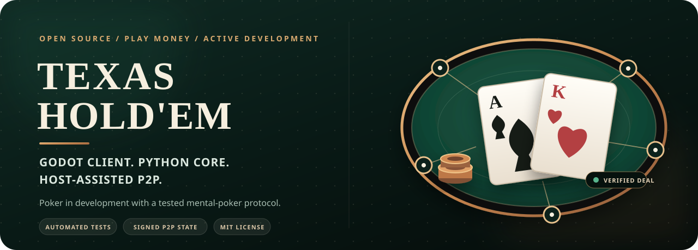
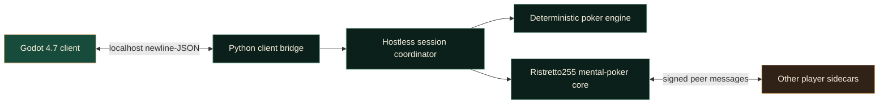
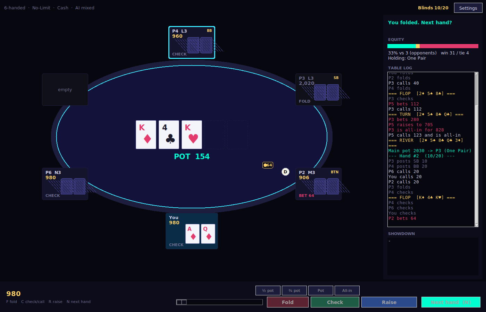

<p align="center">
  
</p>

<p align="center">
  <a href="https://github.com/nephrium83/texas-holdem/actions/workflows/ci.yml"></a>
  
  
  
  <a href="LICENSE"></a>
</p>

<p align="center">
  <strong>A rules-correct Texas Hold'em engine evolving into a serverless Godot experience.</strong><br>
  Godot renders the table. Python owns the rules. Every peer verifies the deal.
</p>

---

## Why this project

Texas Hold'em is a play-money desktop poker project built around a deterministic
Python engine and a hostless mental-poker protocol. Instead of moving poker
logic into the UI or trusting one machine to deal, the architecture gives every
peer the same rules engine, signed state transitions, and cryptographically
verifiable deal inputs.

The Windows preview uses Godot 4.7.1, connected to the Python sidecar through
a locked newline-JSON protocol. Extract the complete preview ZIP and
double-click `Poker.exe` to practice against bots or host and join a LAN table.
No separate Python, Godot or terminal setup is needed. Casual LAN games include visible
30-second turn clocks, automatic Next Hand, and continued play after a non-host
leaves. See [Playing on your local network](docs/LAN_PLAY.md) and
[Windows preview builds](docs/BUILD_WINDOWS.md). The earlier Tkinter harness
remains available for development.

New hands begin with a short shuffle-and-deal animation. Local opponents
pause before acting, so an opening fold follows a visible deal.

<table>
  <tr>
    <td width="50%">
      <strong>Rules before rendering</strong><br>
      Betting legality, position, side pots, refunds, showdown order, and
      settlement live in one headless engine.
    </td>
    <td width="50%">
      <strong>No trusted dealer</strong><br>
      Ristretto255 threshold ElGamal, DLEQ proofs, shuffle auditing, and
      post-hand verification power the mental-poker core.
    </td>
  </tr>
  <tr>
    <td width="50%">
      <strong>Hostless continuous play</strong><br>
      Stack carry, dead-button rotation, eliminations, heads-up transitions,
      void-and-redeal, and final winner delivery run on every peer.
    </td>
    <td width="50%">
      <strong>Built to be tested</strong><br>
      Python tests, a GUI smoke run, and Godot GUT execute in CI
      across Python 3.10, 3.12, and 3.13.
    </td>
  </tr>
</table>

## Project status

| Layer | Status | What that means |
| --- | --- | --- |
| Poker rules engine | Implemented | No-Limit, Pot-Limit, Fixed-Limit, side pots, refunds, odd chips, tournament and cash procedures |
| Mental-poker core | Implemented and tested | Distributed key ceremony, shuffle chain, selective decryption, audit, cheat detection, and mandatory Bayer–Groth prevention for production P2P tables |
| Hostless session | Implemented on the LAN transport | Signed betting, continuous hands, stack carry, bust-outs, spectators, and casual survivor continuation |
| Godot sidecar bridge | Implemented | Versioned snapshots and commands over localhost newline-JSON |
| Godot player experience | LAN preview | Portable Windows launcher, local bots, authenticated Host/Join, Ready, visible clocks, and casual departure handling |
| Internet P2P transport | Planned for v1.x | Joining across different networks, relay/NAT traversal, and network reconnection remain |

> [!IMPORTANT]
> This is an experimental, play-money project. The cryptographic protocol has
> extensive automated coverage but has not received an independent security
> audit. It is not intended for wagering, custody, or real-money play.

## Architecture



The client is intentionally thin. It renders snapshots and sends commands; it
does not recalculate legal actions, pots, winners, or card state. See the
[Godot-sidecar protocol](docs/GODOT_PROTOCOL.md) for the versioned contract.

## Poker engine

The public Python embedding interface lets another game host a poker minigame
with its own presentation, player IDs and play-currency integration. The
dependency-free rules installation is `python -m pip install .`; the
[RPG tavern example and integration guide](docs/EMBEDDING.md) demonstrate
independent tables, private player views and retry-safe mock-wallet cashout.
The standalone Godot host uses the public `SessionPlayer` adapter over its
existing cryptographic sessions. See [package options](docs/PACKAGING.md).
Unity/Unreal adapters and a production MMO or money service are not provided.

- No-Limit, Pot-Limit, and Fixed-Limit betting with correct raise reopening.
- Two to nine seats, including correct heads-up position and action order.
- Layered side pots, uncalled-bet refunds, and odd chips left of the button.
- Dead-button movement, owed blinds, sit-out/return, straddles, and big-blind ante.
- Run it twice, rabbit hunting, showdown order, mucking, and all-in tabling.
- Cash buy-in rules, top-ups, auto-rebuy, tournament levels, clocks, and time banks.
- Four AI styles across three skill levels with range, equity, and pot-odds decisions.

## Trustless deal

The mental-poker path is peer-symmetric: every active seat participates in the
key ceremony, shuffle, selective decryption, betting replica, and post-hand
audit. A detected cheat or state divergence fails the hand closed for the
entire table rather than allowing peers to continue on conflicting state.

Implemented building blocks include:

- Ristretto255 group operations backed by libsodium.
- Threshold ElGamal encryption and re-encryption.
- Schnorr proof-of-possession for key shares.
- DLEQ-proven partial decryptions.
- Bayer–Groth verifiable shuffle for production P2P tables plus mandatory post-hand audit.
- Cut-and-choose shadow-deck shuffle proof, available standalone.
- Signed hostless wire messages and hand-scoped buffering.

The real internet transport is deliberately separate from the protocol core.
Today, multi-peer sessions are exercised through an in-memory transport; the
libp2p/relay path and physical-machine playtest remain v1.x gate work.

**Prevention mode.** The Bayer–Groth verifiable shuffle is integrated into the
mental-deal coordinator and is **mandatory** for peer-to-peer play, set
table-wide by the host as `deal_policy: "bayer-groth-v1"`. Every shuffler
attaches a proof and every peer verifies it before accepting the deck; a
missing, undecodable, or invalid proof voids the hand fail-closed and names
the shuffler.

**There is no default.** A table that declares no `deal_policy` is refused
before it starts, and on a real peer-to-peer transport `"bayer-groth-v1"` is
the only value accepted — a host cannot downgrade a table by omitting a
setting. `"detection-only-v1"` stays available for in-process harnesses and
benchmarks, and must be declared explicitly there too.

**Performance policy:** the published coordinator timings are historical,
exclude real transport, and do not establish the current product timing
gate. Earlier figures also predate the shuffle-verifier soundness fix.
Security parameters are not reduced to satisfy timing targets.
See [the performance budget](docs/PERFORMANCE_BUDGET.md), the
[shuffle benchmark](docs/BG_SHUFFLE_BENCHMARK.md), and the
[L5 performance baseline](docs/L5_SCOPE.md).

## Play the Godot client

For the Windows game, extract the complete preview ZIP and open `Poker.exe`.
This is the player client; Python package installation alone does not include
the Godot executable or game assets. See [Windows builds](docs/BUILD_WINDOWS.md).

The `holdem` command, `python -m holdem`, and `python main.py` all select the
same Godot launcher. For source development, supply its runtime files explicitly:

```powershell
python -m pip install -e ".[internet]"
python -m holdem --godot "C:/path/to/PokerRuntime.exe" --pck "C:/path/to/poker.pck" --libsodium "C:/path/to/libsodium.dll"
```

`python -m holdem --help` lists the launch and diagnostic options. Use the
reviewed runtime files described in [the build instructions](docs/BUILD_WINDOWS.md).

## Legacy Tkinter development harness

The old interface remains available only as an explicit development tool:

```bash
git clone https://github.com/nephrium83/texas-holdem.git
cd texas-holdem
python -m venv .venv
python -m pip install -e ".[desktop]"
python -m holdem.gui
```

Python 3.10 or newer is required. Tk is required for the legacy harness and is
included with standard python.org Windows installers.

<details>
  <summary><strong>View the legacy Tkinter player interface</strong></summary>
  <br>
  <p align="center">
    
  </p>
  <p>
    This is the legacy development harness. The player client uses Godot.
  </p>
</details>

The installed alias `holdem-legacy-tk` opens the same harness. Its optional old
freezer target is `packaging/legacy_tk.spec`, producing
`Texas_Holdem_Legacy_Tk.exe`; it is not the Windows preview build. The former
ambiguous `poker.spec` target now stops with directions to the Godot build.

## Test the project

```bash
python -m pip install -e . pytest
python -m pytest -q
python tests/gui_smoke.py
godot --headless --path godot -s addons/gut/gut_cmdln.gd -gdir=res://test/unit -gexit
```

| CI job | Coverage |
| --- | --- |
| Python 3.10 / 3.12 / 3.13 | Engine, evaluator, settings, P2P crypto, session, transport, and sidecar tests |
| GUI smoke | Boots the Tk harness headlessly and plays 15 hands |
| Godot 4.7.1 | Runs the checked-in GUT suite headlessly |

The crypto tests require a libsodium build exposing the Ristretto255 API. See
[native/README.md](native/README.md) for discovery rules and build instructions.

## Roadmap

- [x] Rules-complete deterministic Python engine.
- [x] Mental-poker key ceremony, shuffle, deal, and audit.
- [x] Hostless betting replicas and continuous multi-hand sessions.
- [x] Godot-sidecar protocol, socket bridge, scaffold, and CI.
- [x] Bayer–Groth verifiable shuffle, integrated with a mandatory production P2P policy.
- [x] Playable portable Godot client with local bots and LAN Host/Join.
- [x] Visible casual clocks, automatic Next Hand, and signed survivor continuation.
- [x] Two-machine packaged LAN invite playtest.
- [ ] Internet joining, relay/NAT traversal, and network reconnection.
- [ ] Benchmark and optimize the complete cryptographic hand-start path ([#16](https://github.com/nephrium83/texas-holdem/issues/16)).

The current delivery gate is in [LAN_RELIABILITY.md](docs/LAN_RELIABILITY.md),
with decisions and deferred work in [ROADMAP.md](docs/ROADMAP.md).
[L5_SCOPE.md](docs/L5_SCOPE.md) retains the earlier implementation scope.
The protocol and transport rationale live in [MULTIPLAYER.md](docs/MULTIPLAYER.md).

## Repository map

```text
holdem/
  engine.py              authoritative rules, betting, settlement, evaluator
  client_view.py         private/public snapshot boundary
  client_server.py       localhost bridge consumed by Godot
  p2p/                   crypto, mental deal, replicated session, transports
godot/
  project.godot          Godot 4.7 client project
  test/unit/             GUT client tests
docs/
  GODOT_PROTOCOL.md      versioned client-sidecar contract
  L5_SCOPE.md            implementation gate and current roadmap
  MULTIPLAYER.md         serverless protocol and transport design
```

## License

Released under the [MIT License](LICENSE).
